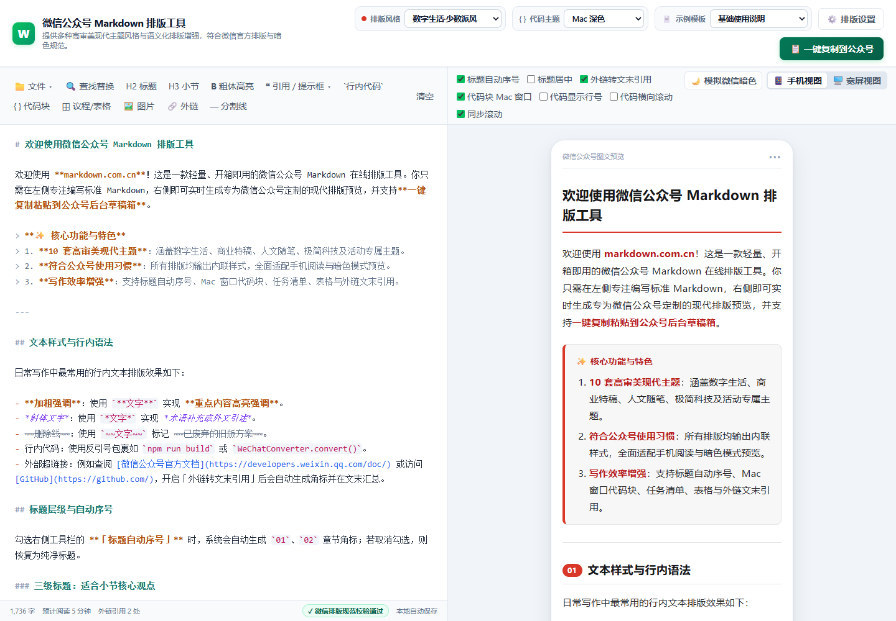

# MDEditor · 微信公众号 Markdown 排版工具

一个可以本地运行、静态部署的微信公众号 Markdown 编辑器。左侧编写 Markdown，右侧实时生成适合公众号阅读的排版，支持一键复制富文本。



## 功能

- Markdown 源码高亮、实时预览、字数与阅读时间统计。
- 10 套文章排版主题、6 套代码主题、4 套示例模板。
- 标题自动序号与居中、外链文末引用、Mac 代码窗口、代码行号和横向滚动。
- 手机与宽屏预览、模拟微信暗色、同步滚动。
- 自定义主题色、字体、字号、行距、段落间距与两侧留白。
- Markdown 导入导出、查找替换、快捷插入标题、引用、代码和表格。
- 图片选择、拖拽与粘贴，本地图片内嵌，无需上传。
- 浏览器自动保存、最多 20 份本地历史快照、富文本复制。

## 本地运行

安装 Node.js 18 或更新版本，然后执行：

```bash
git clone https://github.com/UnityStorming/MDEditor.git
cd MDEditor
npm start
```

打开 [本地编辑器](http://127.0.0.1:5173/wechat/)。根路径 `http://127.0.0.1:5173/` 也可用，按 `Ctrl+C` 停止服务。

应用没有第三方运行依赖，无需执行 `npm install`。运行脚本使用 Node.js 内置模块，所有页面脚本和样式均从本机加载。

Windows 可以使用 PowerShell 启动脚本指定端口：

```powershell
.\start.ps1
.\start.ps1 -Port 5180
```

Linux / macOS 可通过环境变量指定端口：

```bash
PORT=5180 npm start
```

## 部署

项目是纯静态网站，无需数据库、API 服务或前端编译工具。线上使用 HTTPS，以便浏览器支持富文本剪贴板。

### 导出静态文件

```bash
npm run build
```

此命令将页面所需的 8 个文件复制到 `dist/`，保留 `css/`、`js/` 目录结构。将 `dist/` 中的内容上传至静态托管服务即可。构建产物由 `.gitignore` 忽略。

网站使用相对资源路径，可以部署在域名根目录或 `/MDEditor/` 等子路径。静态托管时访问上传的 `index.html` 所在目录；`/wechat/` 是本地 Node 服务器提供的兼容入口。

### GitHub Pages

1. 打开本仓库的 **Settings → Pages**。
2. 在 **Build and deployment** 中选择 **Deploy from a branch**。
3. 选择 `main` 分支、`/ (root)` 目录并保存。
4. 等待 Pages 部署完成，使用该页面显示的网址访问。

仓库根目录已包含可直接部署的 `index.html` 和 `.nojekyll`，这种方式无需运行构建命令。按默认账户和仓库命名，预期地址为 `https://unitystorming.github.io/MDEditor/`；以 GitHub Pages 设置中实际显示的地址为准。

### Nginx 或其他静态托管

运行 `npm run build` 后，把 `dist/` 内容上传至服务器，例如 `/var/www/mdeditor/`。Nginx 静态站点配置可使用：

```nginx
server {
    listen 80;
    server_name your-domain.example;
    root /var/www/mdeditor;
    index index.html;

    location / {
        try_files $uri $uri/ =404;
    }
}
```

将域名和站点目录替换为实际值，再为该域名配置 HTTPS。也可在 Netlify、Cloudflare Pages 等服务上配置构建命令 `npm run build`、输出目录 `dist`。

## 使用方式

1. 在左侧输入或粘贴 Markdown，也可以通过 **文件 → 导入 Markdown** 加载 `.md` / `.txt` 文件。
2. 从顶部选择排版风格、代码主题或示例模板。载入模板前，当前内容会存入本地历史。
3. 使用右侧选项调整标题编号、外链引用和代码块；在 **排版设置** 中微调颜色、字体、字号与间距。
4. 通过手机视图、宽屏视图和模拟微信暗色检查效果。
5. 点击 **一键复制到公众号**，在微信公众号后台的图文编辑器中粘贴，并使用后台手机预览检查最终效果。
6. 使用 **文件 → 导出 Markdown** 备份源码；通过 **文件 → 本地历史版本** 保存或恢复快照。

本地图片可以从工具栏插入，也可以拖入编辑区或粘贴截图。支持 JPG、PNG、GIF、WebP，每张不超过 5 MB；在线图片可填写 HTTP(S) 图片地址。

### 快捷键

| 操作 | Windows / Linux | macOS |
| --- | --- | --- |
| 加粗 | `Ctrl+B` | `⌘B` |
| 斜体 | `Ctrl+I` | `⌘I` |
| 插入链接 | `Ctrl+K` | `⌘K` |
| 查找替换 | `Ctrl+F` | `⌘F` |
| 导出 Markdown | `Ctrl+S` | `⌘S` |
| 复制公众号富文本 | `Ctrl+Enter` | `⌘Enter` |

格式快捷键在编辑区中使用。`Tab` 插入两个空格，`Esc` 关闭菜单或对话框。

### 草稿和剪贴板

草稿和历史仅存储在当前浏览器的 `localStorage` 中，按协议、域名和端口隔离。切换访问地址或清除站点数据后，原草稿不会出现在新地址；请定期导出 Markdown 备份。

复制功能同时写入带内联样式的 HTML 与纯文本。请通过 HTTPS 或 localhost 访问，并允许浏览器的剪贴板权限。

页面加载后，Markdown 编辑与预览无需联网；文章自行引用的在线图片需要网络。

## 项目结构

```text
index.html                  页面与对话框
favicon.svg                 网站图标
css/app.css                 编辑器界面样式
js/themes.js                文章主题与排版设置
js/templates.js             示例模板
js/converter.js             Markdown 转换与代码高亮
js/editor-highlight.js      源码高亮与本地图片处理
js/app.js                   编辑、预览、存储与剪贴板交互
scripts/serve.mjs           无依赖本地静态服务器
scripts/build.mjs           静态部署导出
scripts/verify.cjs          浏览器功能验证
start.ps1                   Windows 启动入口
evidence/                   验证截图与资源清单
```

## 验证与开发

18 项浏览器功能检查通过，包括所有主题与模板、实时转换、布局设置、查找替换、刷新恢复、历史恢复、导入导出、本地图片、HTML / 纯文本剪贴板、断网编辑及 390 px 手机布局。调查过程与覆盖边界见 [RECONSTRUCTION.md](RECONSTRUCTION.md)。

开发验证使用本机 Chrome 和 Playwright；应用运行与静态部署无需 Playwright：

```bash
npm install --no-save --package-lock=false playwright
# 在另一个终端先运行 npm start
npm test
```

测试默认使用 5173 端口，可用 `TEST_URL` 指定其他地址，或用 `PLAYWRIGHT_MODULE_PATH` 指定已有 Playwright 模块目录。测试使用独立临时浏览器配置。
